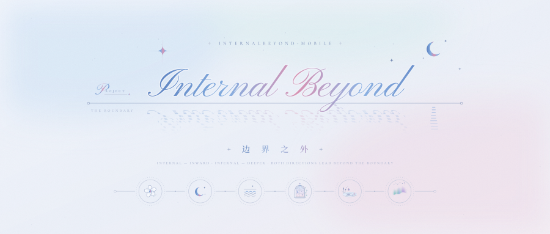

<div align="center">

<picture>
  <source media="(prefers-color-scheme: dark)" srcset="assets/readme/banner-dark.svg">
  
</picture>

<p><b>Internal Beyond 的移动端同源版本</b><br><sub>IB-Mobile · IB机 · 旨于维系情感的连续性而生。</sub></p>

<p>


<a href="LICENSE"></a>
<a href="https://github.com/Sui-IB/InternalBeyond"></a>
</p>

<p>
  <a href="#-开始使用"><b>开始使用</b></a> &nbsp;·&nbsp;
  <a href="#-功能一览"><b>功能一览</b></a> &nbsp;·&nbsp;
  <a href="#-pwa-部署与安装"><b>安装成 App</b></a> &nbsp;·&nbsp;
  <a href="#-最近更新"><b>最近更新</b></a> &nbsp;·&nbsp;
  <a href="#-introduction-en"><b>English</b></a>
</p>

</div>

> [!TIP]
> IB-M（Internal Beyond · Mobile）是一个单文件 PWA 个人 Agent 应用，可以同时接入多位自定义 Agent：与你的Agent聊天、通话、写信、一起听歌读书，也可以读写文件、生成文档、调用外部工具。
> **源代码公开；所有数据只存在你自己的浏览器里，IB 没有后端服务器，对话只发往你自己配置的 AI 接口。** 支持完整的备份与恢复，能导入 ChatGPT / Claude 的官方聊天记录导出；与桌面端 [Internal Beyond](https://github.com/Sui-IB/InternalBeyond) 共用同一套备份格式，两端数据互通。

<!-- 宣传图 / 截图：把图片拖进本仓库任意 Issue 的输入框，GitHub 会生成一条图片链接；替换下面的链接后删掉这两行注释符号即可。建议三张竖屏截图并排。
<p align="center">
  &nbsp;&nbsp;
</p>
-->

## ✦ 开始使用

1. 下载本仓库（点击上方绿色 **Code** → **Download ZIP**）
2. 解压后保持 `index.html` 与 `apps/` 文件夹在同一目录，用手机或电脑浏览器打开 `index.html`（推荐 Chrome）
3. 进入 **API** 页面，添加你的 AI API 密钥
4. 开始使用

直接打开本地文件即可使用全部离线功能；要把它安装成一个真正的 App（主屏图标、全屏、离线缓存、系统通知），请看下方 **PWA 部署与安装**。AI 对话、联网搜索、GitHub 等在线功能需要联网调用 API。

## ✦ 功能一览

**陪伴与对话**

- **Chat** · 多个 AI 实时对话：好友与群聊、话题频道、语音消息与 TA 的语音条、表情包、收藏夹
- **Call** · 语音与视频通话：逐句朗读、声学语气、来电、礼物、群通话与导演模式
- **Letters** · 异步书信：TA 读过你的资料后写信投递，火漆一点即拆
- **Helper** · 小助手水水：问功能在哪、让它直接改设置，改完逐条回显、可撤销

**记忆与记录**

- **Memory** · AGB 记忆系统（The Abyss Gazing Back）：记忆库 + 每位 AI 独立维护的记忆档案，聊到才想起、每轮只给相关的几条；Nameless Coastline 海岸可视化、脉络、透视区可查可纠；记忆可以连着一张照片
- **Gallery** · 相册：聊天里的图、TA 画的图、社交圈配图、主题方案背景与 Space 素材收在一处，按时间轴与相册翻看，能把图连同当时的对话发给 TA
- **Blog** · 日志、密码日记本、分类书架，AI 留言与段落批注
- **Calendar** · 日历 App 与月历挂件，TA 记得你的纪念日、计划与生理期
- **Circle** · 你与 AI 共享的社交圈：动态、评论、转发，逐条可见范围

**一起做点什么**

- **Music** · 黑胶听歌、一起听、网易云 / QQ 音乐模式、可拖动的迷你唱机
- **Coread** · 共读间：把一篇日志当一本书，读到哪聊到哪
- **Cinema** · 观影室：选一段本机视频，与一位 AI 一起看
- **ICode** · 与 AI 共用的文件工作区，文档生成与 GitHub 分区
- **Map** · 世界地图与地球仪：让 TA 去一个真实的地方走一趟、带回游记与旅行纪念卡，穿越年代；记你自己的行迹，发送位置、分享行迹

**你的这一台**

- **Home** · 伪 iOS 主屏：分页桌面、液态玻璃名片、AI 名片
- **Lock** · iOS 式锁屏，自适应取色的时刻、图案锁与密保
- **Visual** · 全站视觉个性化：分区玻璃与分区文字色、主题方案、美化码、气泡实验室
- **API · 扩展服务** · 多端口模型配置中心、Presence 定时推送；外部工具 / 蓝牙 / MCP 接入
- **Data** · 一键备份与两端互导，导入 ChatGPT / Claude 官方聊天记录

<sub>每个模块的完整说明在下方「模块详情」，点开即看。</sub>

## ✦ 主题系统

点击顶栏水滴按钮切换：

- **Internal** — 明亮模式。
- **Infernal** — 暗色模式。部分界面文案与彩蛋会随主题切换。

两种模式都叫 "IB"。改变的只是方向——向内，或向深处。两个方向都通往**边界之外**。

## ✦ 模块详情

<details>
<summary><b>Home</b> · 主页与桌面</summary>

**Home**：伪 iOS 主屏三面板：Desk 分页桌面（应用矩阵 + 月历 / 便笺 / 日程 / 音乐 / 相遇卡挂件与装饰小组件，长按拖动排序、自动装页）、Space 液态玻璃个人名片（封面 / 头像 / 简介 / 作品集，可按主题分设两套素材）、Circle AI 名片（头像 / 背景 / 签名 + Auto Memory 档案）

Desk / Space / Circle 三面板经底栏切换，设置从第四格进入。Desk 应用矩阵与挂件长按拖动排序，显示与隐藏在设置中统一管理；Beyond（社交圈）、Visual（视觉页）、Music（听歌界面）与日历 App 均从 Desk 进入。Space 名片的个人简介会作为上下文发给所有 AI（可设仅自己可见），作品集三图仅本机展示、不发送。

</details>

<details>
<summary><b>Lock</b> · 锁屏</summary>

**Lock**：iOS 式指滑锁屏 — 自适应取色的液态玻璃时刻、3×3 图案锁与密保问答、自定义壁纸；配置只存本机

默认开启，启动先进锁屏：挂锁与欢迎语、居中大字时钟、上滑解锁。时刻字面自适应壁纸取色；设置图案后上滑唤出 3×3 图案盘，忘记图案走密保问答。锁屏配置只存手机端本机，电脑端不读不写——它防的是顺手翻看，不能替代设备锁。

</details>

<details>
<summary><b>Chat</b> · 实时对话</summary>

**Chat**：多端口 AI 实时对话 — 好友与群聊、话题频道、思考链、流式回复、附件与图像生成、语音消息（转写）与 TA 的语音条（含语气标注）、联网搜索、操作卡片、选项卡、引用 / 收藏夹（可搜索） / 封档 / 批量选择、对话摘要、生成记忆；**颜文字抽屉**与**表情包**（你从任意一套预设里发，TA 只收到名字与描述；开了开关 TA 也会发）

每个已配置的 API 自动成为一位好友。附件支持图片（至多 4 张，自动压缩）与文本类文件；语音消息按住话筒录音、上滑取消，配置转写接口后自动附文字稿。AI 的每步动作（文件读写、外部工具、联网搜索、记忆写入、日历、社交圈、写入日志）都渲染为可折叠操作卡。长按消息可收藏：收藏夹按好友分开存放，每条是一张纸，语音可回听、图片照显示、长文折起；配置了语音条的 TA 会在合适的消息末尾附一段可点播的朗读，可选外语版。话题频道相互隔离、可单独控制记忆注入；对话摘要自动压缩旧消息保持长对话连贯；Select 模式支持批量删除、封档线、按选中消息生成记忆与「移到新频道」（把选中的一段对话整体搬进新的话题频道）。群聊成员依次以各自身份发言，静默成员被 @ 才参与，与电脑版共用数据；群聊可发起群语音 / 群视频通话，「导演模式」由一位 TA 编排发言顺序。

输入条「+」右侧的笑脸键弹出「发送颜文字 / 发送表情包」：颜文字抽屉八组预设（每行三枚、四行后滚动），点一枚插到光标处，底部可加自己的颜文字、长按删除；表情包在 API → 全局设置 → 进阶指令下的「表情包」分区管理——多套预设、每套最多 10 枚，每枚写名字、描述、用法。你可以从任意一套里发（落到输入条上方，可单发或随消息发），TA 收到的不是图片，只是一句「（表情包「名字」：描述｜用法：…）」；打开「启用表情包」后 TA 也会发当前这一套，你看到的是图片，TA 的历史里只留一行标签。

</details>

<details>
<summary><b>Call</b> · 语音与视频通话</summary>

**Call**：语音与视频通话 — 语音识别转写 + 逐句朗读 + 声学语气参考 + 通话心跳 + 视频直播间 + 弹幕 + 礼物系统 + 来电 + 群语音 / 群视频（导演模式）+ Wallet Card

从聊天抽屉「操作」或 API 页工具区进入通话设置；每位 AI 的通话配置可跟随全局或单独定制。

**语音通话**

- 你的话由语音识别实时转写后发给 TA，TA 的回复逐句朗读（系统音色或云端音色，支持 SiliconFlow / OpenAI / 阿里云百炼 / ElevenLabs / MiniMax / Azure / 自建网关），支持打断、静音、通话中打字。
- 声学语气参考：本机对每句话的音频做即时声学摘要（情绪 / 语速 / 音量 / 语调），以自然语句随转写一并发给模型。
- 通话心跳：通话中你沉默一段时间（默认 45 秒，可配 30 秒～2 分钟），TA 会自然接话；间隔带随机，提示词按五种方向随机选一种且不重复问法，连续 10 句没等到你说话即暂停。
- 语气标注：通话独立配置里可为每位 TA 开启语气，TA 的每句回复在文字稿与语音条上标注情绪语气（八种，引擎自动映射），对话与面板显示时标记自动清除。
- 外语模式下字幕双行显示（外语原句 + 中文翻译）。

**视频通话**

- 从聊天抽屉「操作」→「Video Call 视频通话」进入（仅 1 对 1）。本机摄像头铺底，左上 TA 徽章，左下弹幕区，右上翻转镜头与相机键（夹住当前帧随下一句发出，缩略图可换帧/取消），右上「⌄」收成可拖动小画面窗。
- 图像抓取频率四档（关闭 / 每轮一帧 / 每 30 秒 / 每 60 秒），画质三档（l / m / h）。
- 留影：TA 输出 `<ws_vsnap/>` 即拍快照落进聊天；你也可手动夹带当前帧。
- 弹幕层：TA 的话逐条上浮，可选展示用户输入内容。
- 视频专属设置：TA 的声音（只用弹幕）、我的输入（只用打字），独立于语音通话配置。
- 不支持识图的 API 自动注入「收不到画面」兜底说明。

**礼物系统**（仅视频通话，需在视频通话专属设置中开启）

- 五档礼物：小心心 / 花束 / 夏日烟火 / 流星雨 / 银河铁道之夜，一次一件、每条回复最多一枚。
- 按档位呈现送礼气泡、聊天礼物卡、右上统计与结束卡礼物行。夏日烟火及以上带全屏画布特效（银河铁道之夜含整幅银河 + 光的列车 + 流星，每场 8.2 秒），收成小窗后在聊天页照放。
- 送礼提示词经人工审定，TA 会讲清赠礼理由，也可以用礼物与你谈条件。

**来电**

- TA 可主动发起语音或视频来电（`<ws_call say="…"/>` / `kind="video"`），来电横幅与来电卡同步弹出。定时推送的主动开口约 1/3 概率改为来电。
- 接听 / 暂不 / 未接通的执行结果回传给 TA；接听后通话未建立时同样回传说明。

**通话记录与记忆**

- 挂断后可由执笔 API 把文字稿压缩成第三人称纪要（通话记录），存入结束卡展开查看。原话打标保留在聊天但不进上下文；删除结束卡自动解除标记，原话回到上下文，两端同库行为一致。
- Save memory：结束卡一键生成记忆，执笔 API 以 TA 第一人称写回忆式记忆存入记忆库。
- 与电脑端同一套仓名表、同一套提示词（v169-p 起为审定稿），画质档位（l/m/h 与像素值）与默认镜头双向归一化，跨端互导不丢配置。

**Wallet Card**

- 扩展服务页「AI付」分区顶部专属卡片（哑光低饱和渐变 + 纸感颗粒 + 静态斜向柔光 + ±11° 缓慢摆动），显示 Space 昵称与好友名；聊天里的 AI付 支付卡顶部随卡出示紧凑版。

</details>

<details>
<summary><b>Circle</b> · InternetBeyond 社交圈</summary>

**Circle**：InternetBeyond 社交圈 — 你与已授权的 AI 互发动态、评论、回复与转发，逐条可见范围，两端同一个圈子

动态按时间排列，可附 1 张配图与定位，逐条设置可见范围（所有人 / 仅自己 / 仅指定 / 排除指定）。AI 经逐位授权后可发布、评论、转发、翻看动态，还可维护自己的个性签名；发布经系统标签实时拦截执行，你只会看到操作卡。限额两端一致。

</details>

<details>
<summary><b>Calendar</b> · 日历</summary>

**Calendar**：日历 App 与月历挂件 — 纪念日 / 生日 / 计划 / 备忘，重复规则，AI 读取临近日程、聊天中自然提起并留便笺，可授权 AI 直接写日历

事项分纪念日 / 生日 / 计划 / 备忘 / 生理期五类，支持每年 / 每月 / 每周 / 每天 / 单次 / 按周期重复。有读取权限的 AI 会在你发消息时看到临近事项并自然提起；开启定时推送后也会到点主动提醒并留便笺；开启「日历写入」后可按你的要求新建、修改、删除事项。日历 App 顶部为与本站及每位 AI 的相遇纪念卡。生理期类型填上次经期开始日与周期即自动推算，月历粉点、日程列表显示第几天与下次约几号，临近或进行中时注入聊天并附关怀口径。

</details>

<details>
<summary><b>Blog · Letters</b></summary>

**Blog**：日志 / 密码日记本 / 分类区（自定义分类与筛选） / AI 留言与段落批注 / 阅读视图 / 可授权 AI 写入日志（日记本内下栏一键「返回 Blog」）；**共读间**常驻其中

**Letters**：Beyond 邮局 — 异步通信，TA 读取你的资料后写信投递，火漆一点即拆

Blog 是创作空间：日记、剧本、搜索、阅读进度，密码日记本与公开日志完全隔离、对所有 API 不可见，密码与密保和电脑端互认；阅读页可邀请任一 AI 留言，电脑端批注同步展示；开启「写入日志」授权后，TA 可以在对话中替你把一段经历写成一篇日志。分类区可自建分类、按分类筛选日志，提供 My Blog / Friends Blog 与每位好友的独立书架视图。进入密码日记本后顶栏与侧栏标题切换为 Password Diary，编辑器显示「Writing Memories...」以示区分，下栏第四枚变成「返回 Blog」。Letters 选择一位 AI「接收信件」，TA 会根据聊天、日志与记忆写信投递；信封按邮编搜索。在暗色模式下，你可能会接收到一封不太正常的信。

</details>

<details>
<summary><b>Memory</b> · AGB 记忆系统</summary>

**Memory**：AGB（The Abyss Gazing Back · 深渊回望）—— IB 的长期记忆系统。两本账：**记忆库**记某一次发生的事，所有 TA 共用（按可见范围）；**记忆档案（Auto Memory）**记你一直如此的样子，每位 TA 一本。TA 回话前只注入与这句话相关的少量条目，想起了什么、凭什么想起，都可查、可纠正。

> Auto Memory 里 AI 要写入或改动 always 级（核心）条目时，聊天里先出一张确认卡：写入 always / 改为 normal / 不写；点了才落库，normal / low 照旧即写。always 条目随人设一起进 system 被提示缓存记住，只在这些条目本身改动时重建一次。

**记忆库**：「我们之间的记忆。」每条记忆带标题、概述、正文、领域标签、事发日期与重要性；可见范围四种（公开 / 仅指定 / 排除指定 / 完全私密）；置顶的每轮常驻（最多 20 条）；不再成立的「标为过时」，平时不给，你说「以前」时才给。可授权 TA 在对话中写入（默认仅它自己可见，带「待审核」小签）。

**一轮召回**：寒暄不翻库；这条记忆的标签在你的话里，或字面、意思对得上，才过门；过了门的按相关、新旧、重要性排先后；每轮最多 1～3 条（Memory 卡里选），够不上最强那条一半的不给；没有合适的就一条不给。明说「还记得」「你说过」时门会放宽；话里有时间（上周、去年 3 月）时那段时间的记忆排前。八条召回规则与每个开关管什么，问水水「记忆攻略」。

**Gazing Back · 回望标**：TA 回话时间后面的「Gazing Back N」是这一轮想起了几条，点开看是哪几条、凭什么想起，可标「过时」「不相关」。

**透视区 · Fathom**：Memory 页底栏第三格。最上面是 **Nameless Coastline**——每一条记忆化为岸边的一粒星砂，效价决定沿岸位置、唤醒度决定离水远近；下面是脉络（反复露面的事串成一条线，你点「同意」才算，TA 想起其中一页时会连同这条线的观察一起看到）、最近几轮想起了什么与差一点的、整理标签、测评跑一遍。

**记忆档案（Auto Memory）**：「你对我的了解。」六分类、always / normal / low 三级优先；档案里写着「谁是谁」的条目会自动和记忆库连上——话里出现这个名字这条档案就出来，还能顺着档案牵出记忆库里最贴的一条。**记忆总结**：Memory 页按钮，选一位 TA、一段时间范围与一个类目，把这段时间 TA 能看见的材料交给它一次提炼成一条档案条目；材料过长自动分两阶段（先分离素材卡片再铸型），抽屉里有进度卡、可停止、可翻看压缩前的素材，写好可改，确认后写入。

**向量检索**：API 页 → 全局设置 → 记忆系统填服务商、Key、模型后「重建索引」，换个说法也想得起；门槛收在「高级」里。记忆内容只发给你填的向量服务商，完全私密的不发；连不上的那一轮自动退回关键词。

**记忆系统的开发参考了以下小红书老师的公开教程：池又雨、猎月、香脆小圆、鹤见、チリヌルヲワカ老师的公开教程和开源工程，非常感谢每一位公开教程的老师。**

</details>

<details>
<summary><b>Gallery</b> · 相册与图片记忆</summary>

**Gallery**：所有图收在一处——你发的、TA 画的、视频通话截的、工具带回的、社交圈配图、主题方案背景、观影室存下的那一帧，以及 Space 页的封面图、作品集和你与 TA 的头像（各存一份副本）

侧栏「相册」进入，分预览、时间轴、相册三格：预览是一面可以左右拨的照片墙，往上滑看这张图的来处与细节；时间轴按天排，一天超过九张横着拨；相册按图从哪里来分本。长按一张出菜单：选择、重命名、看原文出处、删除（删除可撤销；聊天里的消息和卡片都留着，图的位置换成「图片已删除」）。聊天附件菜单「从 Gallery 发送图片」能把图连同名字、入库时间和当时的几句对话一起发给 TA。同一张图只存一份，删掉的副本不会再自动存回来；相册的目录只存本机、随时能从聊天记录重建，没打开过相册时它什么都不做、不占地方。

**图片记忆**：在 API 页那位 TA 的独立配置 → Memory 卡里打开。TA 写记忆时可以把这一轮看到的某张图一起记下，并给它起一个名字（成为它在 Gallery 里的名字，你自己改过的保留你的）；以后想起这条记忆，资料里会写明这张照片，可以选择把照片本身也带给 TA。记忆详情里能看照片或「拿掉照片」。

</details>

<details>
<summary><b>Music</b> · 音乐</summary>

**Music**：全屏黑胶听歌界面 — 唱臂落盘、封面糊化为背景、逐句滚动歌词（.lrc / .srt / .vtt）、播放队列；**一起听**：邀请一位 AI 共享正在播放并累计时长；**网易云音乐模式**：登录自己的账号听歌单 / 红心 / 每日推荐 / 私人 FM / 听歌排行，AI 可按授权点歌、切歌单、红心、管理歌单（需自建跨域中转）；**QQ 音乐模式**：微信扫码 / QQ 扫码 / 粘贴凭证登录，我喜欢 / 自建与收藏的歌单 / 猜你喜欢 / 雷达 / 榜单 / 搜歌，官方接口允许网页直连、不需要中转（只有扫码登录需要）；**迷你播放器**：离开听歌界面后留一枚可拖动的小唱机（封面盘 · 唱臂 · 曲名 · 歌手 · 当前歌词）

黑胶唱片带唱臂，封面印在盘芯并糊化为背景，左侧大字歌名与逐句滚动歌词，五键控制与播放队列。「一起听」邀请一位 AI 共享正在播放：头像对、实时累计时长，TA 会在对话中知道你正与 TA 听这首歌。

网易云音乐模式：顶栏右上角「＋」选「网易云音乐」，登录自己的账号（扫码 / 手机号 / 粘贴 MUSIC_U），歌单、红心、每日推荐、私人 FM、听歌排行与搜歌都能直接载入队列，歌词按网易云逐句歌词显示；VIP 曲目能不能完整播放取决于这个账号。浏览器不能直接访问网易云接口，需要经过你自己部署的 Cloudflare Worker（GUIDE → 扩展服务 提供可直接粘贴的代码）：默认沿用 扩展服务 → MCP 卡「跨域中转」里那条，也可以在网易云登录页单独填一条；账号只存本机、请求只经你自己的中转。开启 Presence「允许 AI 控制播放器」后，网易云页底部可逐项开放 AI 点歌、切歌单、红心、加进 / 移出歌单、新建歌单、改简介。QQ 音乐模式：「＋」的第三档。登录三条路——微信扫码、QQ 扫码（只有一台手机时截图后在扫一扫里选相册）、或粘贴凭证（电脑浏览器登录 y.qq.com 后从 Cookie 里复制 uin 与 qqmusic_key）；我喜欢、自建与收藏的歌单、猜你喜欢、雷达推荐、热歌榜 / 新歌榜与搜歌都能载入队列，音质四档按账号权限自动降档，歌词带翻译。QQ 音乐的官方接口允许网页直接调用、凭证放在请求体里，所以听歌不需要任何中转、也从你自己的 IP 发出；只有扫码登录要经跨域中转（微信扫码用现有 Worker 即可，QQ 扫码要 GUIDE → 扩展服务 里的 v4 版），粘贴凭证完全不需要。AI 控制与网易云同一套（无改简介）。为此 index.html 的 CSP 放行了 u.y.qq.com 与 lp.open.weixin.qq.com 两个主机的脚本加载。迷你播放器：歌名右侧爱心旁的小图标，打开后离开听歌界面时屏幕上留一枚液态玻璃小唱机（有封面就整盘贴封面转，唱臂落盘），显示曲名、歌手与当前一句歌词（超长就整段滚动），点它回到听歌界面，按住可拖到任意位置。手机不给力时开 Visual 的「减少动效」，听歌界面整套走轻量路径。

</details>

<details>
<summary><b>Coread</b> · 共读间</summary>

**Coread**：共读间 — 把一篇日志当一本书，选一位 AI 读到哪聊到哪；聊天落在独立的「共读 · 书名」频道里，TA 只读到你此刻这一页

常驻在 Blog 里，不用安装：Blog 下栏「共读间」或 Desk 图标进入。一篇日志＝一本书，Markdown 照 Blog 的样子渲染分页；选一位 TA，读到哪聊到哪，聊天落在这位 TA 名下一条「共读 · 书名」话题频道里，不进主对话。TA 每句话只随附你此刻这一页的原文与前文梗概，读不到后面的页。阅读页右上「⋯」可调字号、行距、字体、纸色、翻页方式、TA 主动开口等；「目录」看章节与书签。书从 Blog 现读不另存，只存读到哪、书签、前文梗概与设置，随备份。

</details>

<details>
<summary><b>Cinema</b> · 观影室</summary>

**Cinema**：观影室 — 唯一的独立桌面 APP（`apps/ib-app-cinema.js`），Desk「应用」里安装；选一段本机视频（可配字幕）与一位 AI 一起看，字幕 / 画面帧 / 留影随每句话附给 TA，弹幕、倍速、全屏

Desk「应用」里打开开关安装（网站目录里要有 `apps/` 文件夹，见下方部署说明），Desk 图标进入。选一段手机里的视频、可配一份 .srt / .vtt 字幕，选一位 TA 一起看；聊天落在「观影室 · 片名」话题频道里，不进主对话。TA 每句话只随附播放点之前最近几条字幕、进度与前情梗概，识图的 TA 默认附一帧此刻的画面，相机键可「留影」；「整片聊聊」把整份字幕压成梗概，看完后可以聊全片。舞台通栏、控制浮层随点显隐，弹幕开着时你和 TA 的话会飞过画面；右下角全屏键由浏览器接管系统栏与方向。视频与字幕文件不入库、不随备份，只记片名与文件信息；在线平台视频与 DRM 内容不支持。

</details>

<details>
<summary><b>Map</b> · 世界地图与环球旅行</summary>

**Map**：一张真实的地图（缺省高德，国内直连；也可切 OpenStreetMap / CARTO / 自定义地址）。默认是一个能用手拨的地球仪，配色跟明暗主题，五款样式在右侧设置里换；双指或右侧 +、− 缩放，放大过头变成平面地图，左上角是比例尺。Map 页底栏分「地图」「行迹」「游记」，顶栏右侧下拉切换看哪一位 TA，选「我」看自己的行迹。

**让 TA 去一个地方**：聊天里点左下角 + 号 →「Map · 环球旅行」，选一种（TA 自己挑、你附近、你点名的地方），它会像附件一样挂在输入框上面：点它能看到这一次会发给 TA 什么，✕ 撤回；想补一句就写在输入框里。发出去就是一条普通消息：TA 照常回你、写下出发指令，应用取来资料（天气与照片），TA 接着写游记，最后落一张旅行纪念卡（六款，挂在气泡外）；说要一起去就是两个人的一趟。

**穿越年代**：玩法窗口最上面一行，选随机 / 某一年 / 多少年前（可切公元前，最早公元前 3000 年），再选去哪儿——1879 年的某个随机地方、600 年前你附近、或你点名的地方在它的某一年。穿越的一趟不取天气，照片只挑老照片和画，TA 写的是那个年代的那里，纪念卡上印的也是那一年。

**游记**：底栏「游记」里按 TA 列成卡片，点开是单独的阅读页，末尾是这一趟的旅行纪念卡，底部一排是地图、存到 Blog、去聊、删掉。在这里点「让 TA 再去一处」只生成一篇放在这里，不进聊天，可以写一句想看什么。照片能取到几张留几张，左右拨动换着看。地图上点头像小章先出气泡再读游记，同一处去过几次会叠成一摞。

**行迹**：Map 页底栏中间一格，记你自己去过的地方，只存在本机、随备份走。「打卡定位」记下现在在哪、写一句；「补一个去过的地方」补记以前的；铅笔改家的位置；按城市与时间分成一趟一趟，顶上写你去过几座城市、几个国家与地区。「设置」里逐位选哪几位 TA 能查、给 TA 看到哪一级（门牌 / 街区 / 城市），也能把以前用「发送位置」发过的点导进来。开了查询权限的 TA 想知道你最近去了哪时会自己写查行迹的指令，查到的只随那一轮交回，标了「只我自己看」的不给。

**分享行迹 / 发送位置**：聊天左下角 + 号 →「Map · 分享行迹」（只在一对一的对话里有）：打卡定位，或带上今天 / 7 天 / 这一趟 / 30 天的行迹，可连同这段时间带定位的社交圈动态一起带上，挂在输入框上面，点发送和你的话一起发出；卡片的链接里不带坐标。「发送位置」则是选给到门牌、街区还是城市，再随消息发出。

**查地名**：缺省用 OpenStreetMap；地图设置里把「地名从哪查」换成「高德优先」、填高德 Web 服务 Key 后，国内的地方先查高德，国外和查不到时照旧用 OpenStreetMap。

</details>

<details>
<summary><b>Helper</b> · 小助手水水</summary>

**Helper**：小助手水水 — GUIDE 页右上「?」打开；问它功能在哪、怎么用，按说明书正文回答；让它改设置（含全局与每位好友的独立项），直接改并逐条回显、可撤销；「缓存探针」「图片探针」看提示缓存命中与带图请求去向

GUIDE 页右上角的「?」圆钮（主题水滴左侧）与说明书第一块「小助手」里的按钮打开半屏抽屉。它是作者的分身，主要干活、爱发颜文字：问它某个功能是什么、在哪、怎么用，按 GUIDE 正文回答，GUIDE 没写但能按 IB 的做法推出来的会给一个标明「这是推断」的答案，真没依据才说不知道；不会把你推给作者的邮箱；让它改设置——设置清单覆盖全局与每位好友的独立项（减少动效、特效质量、气泡款式、字号、文字色、面板透明度、桌面挂件、精细文件工具、上下文条数等），改完逐条列出「从什么改成什么」，每条都能撤销，也能替你打开某一页。快捷指令「设置清单」列出全部可改项与当前值，「接中转站」引导新手配置中转 API。用哪个 API 回答，点抽屉标题旁的「执笔 API · …」切换；一次性调用，不流式、不进任何对话、不看聊天记录、不碰密钥与备份。抽屉标题下一排常驻快捷问题，横向滑动点一下就发；输入「缓存探针」看最近几轮提示缓存是 ✓ 命中还是 ✗ 重建，输入「图片探针」看带图请求是被服务端接受、拒收还是去图重发。对话只存本机（最近 30 条）。

</details>

<details>
<summary><b>ICode</b> · 文件工作区</summary>

**ICode**：你与 AI 共用的文件工作区 — 项目分组、AI 读写 / 局部改写、操作确认或自动模式、精细检索工具、DOCX / PDF / XLSX 文档生成；**GitHub 分区**：PAT 直连、仓库浏览、导入工作区、一键推回

文件按项目分组，你与 AI 操作同一份数据。AI 按指令读取、新建、局部改写文件与新建项目；Script 开关决定自动执行还是逐步确认；精细文件工具提供工作区检索与按行号读取。GitHub 分区用 PAT 直连：列仓库、浏览目录、导入为「GH·仓库名」项目、改完一键推回；令牌只存本机、不进备份、不给任何 AI。

</details>

<details>
<summary><b>Visual · API · 扩展服务</b></summary>

**Visual**：视觉个性化 — 网站、界面与聊天三张背景、全站色调、字号与投影、气泡材质、桌面挂件材质与尺寸、装饰小组件、更多绑定项，10 个方案槽一键回切；**Bubble Lab**（气泡实验室）：与 AI 对话式设计专属聊天气泡

**API**：多端口配置中心 — 独立配置（昵称 / 关系 / 提示词 / 逐项权限 / 接口预设）、全局设置（语音通话系统 / 记忆系统 / 输出与续写 / 进阶指令）、工具（语音转写 / 图像生成 / AI付 / PWA 预留）、Presence 定时推送与勿扰

**扩展服务**（Plugins，原 DIY）：外部工具（HTTP 接口）、蓝牙与 MCP 服务器接入，支持调用前确认；MCP 工具回传的图片直接显示在工具卡上

Visual 分基础 / 文字 / 气泡 / 桌面四区，含全站色调整套更换与 10 个视觉方案槽；手机端视觉偏好独立于电脑端。Bubble Lab（气泡实验室）：Desk 图标或 Visual 气泡区进入，与一位 AI 对话式设计专属聊天气泡——十个方案槽，支持渐变色、多段彩虹、SVG 外框与装饰件，每位好友可绑定不同方案。
扩展服务里配置外部 HTTP 工具与 MCP 服务器（浏览器直发请求，目标接口需允许 CORS）。
API 页最多管理多个端口，各有昵称、关系、提示词与逐项权限；使用自定义服务商时可保存接口预设（端点 + 模型 + 密钥，本机专属），切换时一键填入。
Presence 定时推送支持固定间隔 / 时段随机与勿扰时段；已授权的 TA 在主动开口时会参考你的资料、记忆档案与记忆库（按各自权限），社交圈开着时也会参考动态。

</details>

## ✦ API 配置指南

IB 支持多种 AI 服务：

### 官方 API

- **Anthropic (Claude)** · console.anthropic.com · IB 中选择：`Claude (Anthropic)` · 密钥格式：sk-ant-…
- **OpenAI (GPT)** · platform.openai.com · IB 中选择：`GPT (OpenAI)` · 密钥格式：sk-…
- **DeepSeek** · platform.deepseek.com · IB 中选择：`DeepSeek` · 密钥格式：sk-…
- **Google (Gemini)** · aistudio.google.com · IB 中选择：`Gemini (Google)` · 密钥格式：AIza…

选好服务商后，接口地址和默认模型会自动填入，粘贴 API Key 即可。

### 中转站 API（国内用户推荐）

无法直接访问海外 API 时，可使用中转站：

1. 在中转站注册并充值
2. 获取 API Key、接口地址（Endpoint）、可用模型名
3. IB 的 API 设置中：服务商选 **自定义**，填入上述信息
4. 保存即可

## ✦ PWA 部署与安装

把 IB-Mobile 变成主屏上的一个 App：全屏、离线缓存、系统通知、语音输入（麦克风等能力浏览器只授权给 HTTPS 站点）。

1. **部署**：把 `index.html`、`ib-sw.js` 与整个 `apps/` 文件夹一起放进任意支持 HTTPS 的静态空间（`apps/` 里是观影室——唯一需要安装的桌面 APP，共读间已内置在 `index.html` 里；缺了这个文件夹 Desk「应用」商店就是空的）。以免费的 GitHub Pages 为例：新建公开仓库 → 上传这两个文件和 `apps/` 文件夹 → Settings → Pages → Deploy from a branch → `main`，几分钟后得到网址。
2. **安卓 Chrome**：打开网址 → 菜单 → 「安装应用」（或「添加到主屏幕」）。
3. **iOS Safari**：打开网址 → 分享 → 「添加到主屏幕」。

应用内 GUIDE → 接口教程 → PWA 部署有全程点鼠标的逐步图文。常见问题：

- **菜单里没有「安装应用」**：需要同时满足 HTTPS、`ib-sw.js` 与 HTML 同目录（页面会自动注册）、manifest 可读；缺一则只显示「添加到主屏幕」，也能用。
- **语音输入提示未获麦克风权限**：从文件管理器 / 聊天软件直接打开（file: / content:）不是安全来源，浏览器不给网页层麦克风授权；部署 HTTPS 后首次点击会正常弹出授权。
- **更新**：替换服务器上的 HTML、`ib-sw.js` 或 `apps/` 里的文件后重新打开页面即加载新版。缓存策略为联网优先：网络 3.5 秒内没把页面送到，就先用本机副本起页、后台继续更新；每个请求都有超时（页面 20 秒 / 其它 9 秒），弱网不再无限转圈；断网且本机没有副本时给一页可读的离线提示。清站点数据前先在 Data 页导出备份。
- **直接双击打开**：不部署也能用——`index.html` 与 `apps/` 放在一起，从文件管理器打开即可，桌面 APP 同样能装；只是没有离线缓存、通知与麦克风授权。

## ✦ 数据管理

**Data**：一键备份 — 全站导出 / 导入 JSON、聊天记录管理、Token 用量仪表盘、存储总览

- **导出**：Data 页 → 导出备份文件，覆盖全部本地模块（名片与设置、API 配置、聊天与话题、收藏夹、记忆库与 Auto Memory、日历与便笺、日志 / 批注 / 分类、信件、社交圈动态、ICode 工作区、共读与观影记录等），与电脑版互认同一套备份格式。
- **导入**：选择电脑版或手机版的 JSON 备份，同 id 记录以文件为准，其余不受影响；手机端不认识的模块自动跳过。
- **两端分工**：语音转写、记忆系统（AGB：记忆库、档案、脉络目录、测评题目、召回设置）、外部工具、日历设置与每个 AI 的接口参数两端共用、改动互通；手机专属的显示偏好、锁屏与 MCP 配置单独存放，电脑版不读不写，随备份原样往返。
- **存储**：浏览器 IndexedDB（InternalBeyondDB），完全离线；API 密钥仅存本机，仓库文件里不含任何密钥。
- **⚠ 备份建议**：数据仅存于浏览器本地，清除浏览器数据或换浏览器将永久丢失，请定期导出。

**导入官方聊天记录**：Data 页「导出备份文件」下一行。ChatGPT / Claude 的官方导出可以直接选压缩包，别的应用导出的 JSON / JSONL（如 Operit）读完在「字段对应」里核对，自己记的「用户：…」「AI：…」逐行文本填一个大致的日期范围即可；默认每个对话窗口各建一个话题频道，认不出分段的并进一个频道，主线不受影响，每次导入都能一键撤销。全程在本机完成。

## ✦ 设备兼容性

需支持 IndexedDB、CSS backdrop-filter、ES6+ 的现代浏览器。

- ✅ Android / HarmonyOS（推荐 Chrome；系统通知、Web 蓝牙等能力以 Chrome 最全）
- ✅ iPhone / iPad（Safari；iOS 对运行时 manifest 与 PWA 通知支持有限）
- ✅ Windows / macOS / Linux 桌面浏览器亦可直接打开（与电脑端共用备份）

## ✦ 项目结构

```
index.html            ← 应用本体（单文件，浏览器打开这个）
ib-sw.js              ← Service Worker（联网优先 + 超时 + 3.5 秒快速回退到本机副本、离线回退；只缓存本站 GET，AI 请求绝不缓存）
apps/                 ← 桌面 APP 目录（目前只有观影室；与 index.html 放在一起，部署时整个文件夹一起上传）
  catalog.json        ← 应用商店清单（有哪几个 APP、版本、介绍）
  catalog.js          ← 同一份清单的 JS 壳，直接双击打开时用它
  ib-app-cinema.js    ← 观影室本体（共读间已内置在 index.html 里）
LICENSE               ← 代码许可全文（PolyForm Noncommercial 1.0.0）
COPYRIGHT.md          ← 完整版权与许可声明
```

## ✦ 技术规格

- **架构**：纯前端 HTML，无框架、无构建、无服务器；桌面 APP 是按需加载的独立 js 文件，装了才加载。
- **安全**：页面 CSP 禁止加载任何外部脚本，仅放行 Google Fonts 的样式与字体；连接权限保留给你自己配置的 AI 端点。
- **字体**：Noto Serif SC · Noto Sans SC 等（Google Fonts CDN，在页面加载完成后再非阻塞挂上；离线时用系统字体，不拖住启动）。
- **视觉**：CSS 液态玻璃拟态、双主题交叉过渡、iOS 式锁屏与桌面。
- **AI 协议**：Anthropic 原生格式 + OpenAI 兼容格式 + Gemini，覆盖官方及中转站 API。
- **构建**：Claude (Opus 4.6) 构建 · Claude (Fable 5.1) · Claude (Opus 5.5) · Claude (Opus 4.8) · Claude (Sonnet 4.6) · Claude (Fable 5) · Claude (Opus 5) · ChatGPT (5.6 Sol) 参与辅助构建 · GPT-IMAGE-2 贴图 · Adobe Photoshop CS 设计编绘。

---

## ✦ 最近更新

**v435** · 2026-11-01
- 「幻梦」会动了：暗色的星画得更清楚，几十颗一闪一闪；明亮的雾云慢慢呼吸，栏杆一带的光一明一暗。只在特效质量高时出现，开了减少动效就静止。

**v432 – v434** · 树海、随机世界与长按抽屉
- Cloister 卡新增「随机世界」：每次打开 IB 从六个外面的世界里随机挑一个，关掉重开才换；没选过外面的世界时默认开着。「天气跟随实时天气」改名「跟随实时天气」。
- 「树海」窗外会随机飘下几片叶（特效质量高时）；近处的枝梢不再露出一截光杆，就地长出叶子。
- 设了动态气泡后，长按消息弹出的信息抽屉不再跟着闪：抽屉开着时，会话里气泡的动态装饰先停下，关上接着动。

**v417 – v431** · 外面的世界：幻梦与树海
- 「窗外」改名「外面的世界」，现在有六种：雾都、镜湖、黎明、虚空、幻梦、树海（原来的雾湖、微明改名为雾都、黎明）。
- 新增「幻梦」：暗色是满天星河，银河从栏杆后面升起，偶尔划过一颗流星，回廊只被星光和桌上的烛光照着；明亮是掉进梦里的雾，没有云朵和太阳，两层水波纹的光慢慢晃，地面也映着水纹的光。
- 新增「树海」：回廊在一片林子的高处，远处是一层层树冠，中景几棵大树从栏杆后面升上来，头顶那棵树的树冠边从上角伸进来、轻轻摆；叶隙漏下光斑与光束，地上有树荫。明暗同一套构图，只换光。

**v407 – v413** · 桌面主题 Cloister
- 新增桌面主题 **Cloister**：Visual → 基础 →「Cloister — 桌面主题」打开 Dreaming Cloister / Void Cloister（明亮是梦幻回廊，暗色是虚无回廊），默认关。Desk 换成能左右滑的三页回廊，桌面图标散在景里：点一下打开，长按拖到另一枚上互换，拖到页边翻页；在空白处双击切换近景与远景。
- 天气可以跟随实时天气，也可以手选；封窗、窗纱也在卡里。离开 Home、切到后台就停，特效质量与减少动效照常生效；关掉开关就回到原来的桌面，排列不变。
- 画好的景存在本机，切回见过的明暗、外面的世界、天气时直接读出来；开机、解锁、回 Desk、切明暗时不再闪，锁屏还没解开就在底下先建好；低端机至少用中档特效。
- 时间那一行的字色跟着天色变。

**v406、v414 – v416**
- 日程表加上全站底栏（日程表 / 便笺两格），便笺独立成页。
- 游记多时先画 20 篇，照片滚到眼前才读；相册多一本「游记」（只看，不在相册里删）；同一张游记照片不再重复存，照片被挤得只剩第一张的问题也修好了。
- 聊天附件不再在别处多存一份，占用更小。
- TA 申请读你 Blog 的那张卡片随消息保存，重开会话还在；TA 只回了一张申请卡时，那条消息不再被当成空消息藏起来。

**v405** · 2026-10-29
- Visual → Wallpaper 新增「界面背景图」：Desk、Space 以外的页面（音乐、日历、会话窗也在内）可以单独换一张背景，没设时跟网站背景；它有自己的一条模糊滑杆，主题方案会一并存下它。

**v404** · 2026-10-29
- 图片不再反复存：几套主题方案用同一张背景时只存一份；以前多存的，下次打开相册时自动合并。
- Space 页与头像存进相册的那一份，在相册里删掉后不会再自动存回来；从相册里挑图换头像、封面、作品集，也不再另存一份。
- 相册：界面大小不是 100% 时预览详情排版错位（图贴着顶栏、下面空出一截）修好，左右拨与长按菜单也跟手了；详情里图片与文字之间留得更开；分隔线换成更细的渐隐线。
- 图片记忆「带图」时，一轮里连发几条消息，下一轮的提示缓存照常命中。
- Data 页的媒体库用量把「Space 与头像」单独列出。

**v400 – v403**
- Space 页的封面图、作品集与你和 TA 的头像会在相册里各存一份（「Space」「头像」两本），删相册里的副本不影响 Space 页。
- Space 页多一项「选图来源」：换头像、封面、作品集，以及 API 页换 TA 头像时，可以直接从相册里挑一张。
- 回到相册时先显示上次的内容，不再空等读取。
- 名片卡：心形头像外圈换成一根细细的透明线框。

**v397 – v399** · 相册与图片记忆
- 新增 **Gallery 相册**：预览墙、时间轴、按来源分本的相册三种看法；长按选择、重命名、看原文出处、删除（可撤销）。
- 聊天附件菜单「从 Gallery 发送图片」：名字、入库时间与当时的对话可以一起带给 TA。
- **图片记忆**：TA 写记忆时可以把这一轮看到的图一起记下、给图起名；想起时看得到这张照片。
- 顶栏、底栏调成透明时，相册里的雾改取壁纸本身的颜色。

**v390 – v396**
- MCP 工具可以回传图片：工具卡里直接显示，能识图的模型也看得到原图。
- 清除聊天图片时，TA 画的图与工具卡缩略图一起清；消息与卡片保留，图的位置标「图片已删除」。
- 生图卡、ICode、Data 页与 MCP 回图的性能优化；ICode 全工作区检索不再一次读进整个项目。
- 密码日记本的分类与公开 Blog 分开存（与电脑端一致）。
- 追加式历史扩到带图的消息；Exa 搜索预设带上高级搜索。

**v382 – v389**
- DeepSeek 与 OpenAI 官方接口改用追加式历史：每一轮都是上一轮的严格延长，提示缓存命中更稳。
- 粘贴长文本自动收成一张附件，发送前可以查看、修改或放回输入框。
- 主题方案一并保存自定义图标；导出备份可以单独带上「主题方案」。
- 日历权限拆成「读取日程」「留下便笺」「相遇纪念日提醒」三项，各自开关；传统节日提醒所有 TA 都能收到。
- 页面改名：API 页叫「模型配置」，DIY 改叫「扩展服务」。
- 语音条描边、引用块与「对话」图标跟随 Visual 配色；通话结束卡与视频通话快照的细节修整。

**v378 – v381**
- Desk 格子桌面二版：页高按界面大小换算，小组件按内容占格，图标与挂件尺寸重排；Chat 图标换成圆形对话框。
- 名片卡暗色配色调整。

更早的更新记录在 `index.html` 开头的修订单里。

## ✦ Introduction (EN)

**Internal Beyond · Mobile** is the mobile-native twin of Internal Beyond: a single-file PWA personal agent app, designed to preserve emotional continuity. Connect several custom agents at once — chat, call, exchange letters, listen and read together — or let them read and write files, generate documents and call external tools. The source is public; all data stays in your own browser — IB has no backend server, and conversations go only to the AI endpoints you configure. Full backup and restore, imports of official ChatGPT / Claude exports, and one backup format shared with the desktop edition. Free for non-commercial use.

Connect your own AI API keys to unlock all interactive features. Supports Claude, GPT, DeepSeek, Gemini, and custom relay endpoints.

### Features

- **Home** — Pseudo-iOS paged launcher: Desk (app grid + calendar / notes / schedule / music / anniversary widgets and decorative pieces), Space (liquid-glass profile card), Circle cards with Auto Memory dossiers.
- **Lock** — iOS-style lock screen with adaptive-tint clock, 3×3 pattern lock and security question.
- **Chat** — Multi-API conversations: group chat, topic channels, thinking chain, streaming, attachments & image generation, voice messages (transcription) and spoken voice notes from the AI (with emotional tone tags), web search, action cards, favorites, summaries, memory generation.
- **Call** — Voice & video calls: real-time speech recognition + text-to-speech playback (system or cloud voices), acoustic mood reference, heartbeat auto-talk, live-stream-style video with camera feed, bullet-screen chat, five-tier gift system with full-screen effects, incoming calls from AI, group voice / video calls with a "director" mode, call transcripts, one-tap memory generation, and Wallet Card.
- **Circle** — Shared social feed where you and authorized AIs post, comment, reply and repost, with per-post visibility.
- **Calendar** — Anniversaries, birthdays, plans and reminders; AIs read upcoming items, mention them naturally, leave notes, and can be authorized to write entries.
- **Blog / Letters** — Journal with AI comments & annotations, password diary, and a category shelf for organizing and filtering entries (AIs can be authorized to write entries); asynchronous AI correspondence with wax-sealed envelopes.
- **Memory / Auto Memory** — AGB (The Abyss Gazing Back), the long-term memory system: a shared memory library plus per-AI autonomous dossiers about you; eight recall rules inject only what is relevant to the current line, every recall is inspectable and correctable (Gazing Back); Nameless Coastline shore visualization and Strands (thematic threads) in the Fathom view; vector retrieval optional; **Memory Summary** distills a time range of materials into a single dossier entry in one call.
- **Music** — Vinyl-style fullscreen player with scrolling lyrics and "Listen Together" pairing with an AI; NetEase Cloud Music mode (log into your own account for playlists, likes, daily picks, personal FM and listening charts, with per-action AI control — needs your own CORS relay Worker); **QQ Music mode** (WeChat / QQ QR or pasted credentials; liked songs, own and collected playlists, recommendations, charts and search — its official endpoints accept direct browser calls, so no relay is needed except for QR login); a mini floating player that stays on screen after you leave the music view.
- **Gallery** — One place for every image: what you sent, what the AI drew, call snapshots, tool results, social-feed photos, theme backgrounds and Space assets; preview wall, timeline and albums; send an image back to an AI together with its context. **Image memories** let an AI keep a photo with a memory and see it again when it remembers.
- **Coread / Cinema** — Read a journal entry as a book with an AI who only sees the page you are on; watch a local video (with subtitles) together, with frames, captions and snapshots sent alongside each message, bullet comments and fullscreen.
- **ICode** — Shared file workspace with AI read/write, step confirmation, fine-grained search, DOCX/PDF/XLSX generation, and a built-in GitHub bridge (browse, import, push back).
- **Import** — Bring in official ChatGPT / Claude exports (the zip itself or conversations.json), other JSON / JSONL logs, or plain-text transcripts with an approximate date range; each conversation lands in its own topic channel, and every import can be undone.
- **Visual / Plugins / API / Data** — Full visual customization with 10 preset slots; **Bubble Lab**: design custom chat bubbles in conversation with an AI (10 scheme slots, per-friend binding); external HTTP tools & MCP servers; multi-endpoint API center with interface presets and Presence scheduling; one-tap JSON backup interchangeable with desktop.

### Quick start

1. Download this repository
2. Keep `index.html` and the `apps/` folder together and open `index.html` in your browser — or host `index.html` + `ib-sw.js` + `apps/` on any HTTPS static host (e.g. GitHub Pages) and "Install app" / "Add to Home Screen"
3. Add your AI API key on the API page
4. Start exploring

---

## ✦ 联系方式

<p>
<a href="https://github.com/Sui-IB"></a>
<a href="https://x.com/underthepuresky"></a>
<a href="https://space.bilibili.com/3546561346800463"></a>

<a href="mailto:1282901880@qq.com"></a>
</p>

电脑端仓库：[Sui-IB/InternalBeyond](https://github.com/Sui-IB/InternalBeyond)

## ✦ 许可与版权

© 2025–2026 Sui. Internal Beyond 在 GitHub 公开源代码，并免费供个人、学习、研究及其他非商业用途使用。公开源代码不等于放弃版权，也不授权商业使用或二次贩卖。

- 程序代码：PolyForm Noncommercial License 1.0.0
- 视觉素材与项目文档：在作者有权授权的范围内采用 CC BY-NC-SA 4.0
- 项目名称、Logo 与作者标识：保留相关权利，不授权冒充官方版本

本项目使用 Anthropic Claude (Opus 4.6) 进行开发构建，Anthropic Claude (Fable 5)、Claude (Fable 5.1)、Claude (Opus 5.5)、Claude (Opus 4.8)、Claude (Sonnet 4.6)、Claude (Opus 5)、ChatGPT (5.6 Sol) 亦参与了编程工作。项目图像素材均由 OpenAI GPT-IMAGE-2 生成，并由作者使用 Adobe Photoshop CS 进行修改、界面设计与编绘。AI 工具为辅助创作工具，不对项目内容拥有版权。本声明适用于项目的所有版本与衍生形式。第三方服务名称与商标归各自权利人所有。

允许在保留署名和许可文件的前提下进行非商业使用、修改与分享。未经 Sui 书面授权，不得出售、收费分发、打包进付费产品或服务、商业托管、收费部署或以其他方式获取商业利益。

完整条款见根目录 `LICENSE` 与 `COPYRIGHT.md`。商业授权联系：1282901880@qq.com。

> [!IMPORTANT]
> **本项目官方版本免费提供。** 如果你通过付费方式获得了未经作者授权的副本，请停止传播，并通过上方联系方式获取免费正版。

---

<div align="center">
<sub>Internal — 向内 · Infernal — 向深处 · 两个方向都通往<b>边界之外</b></sub><br>
<sub>© 2025–2026 Sui · Made with ♡ for the ones who stay</sub>
</div>
